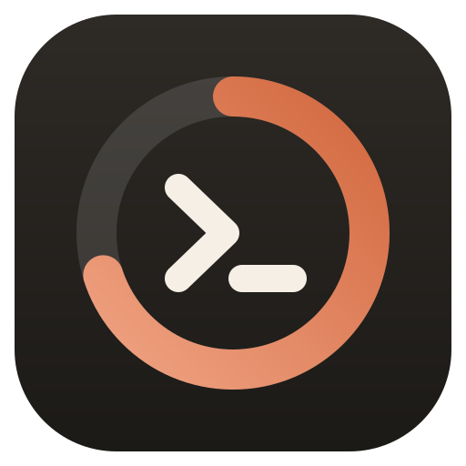
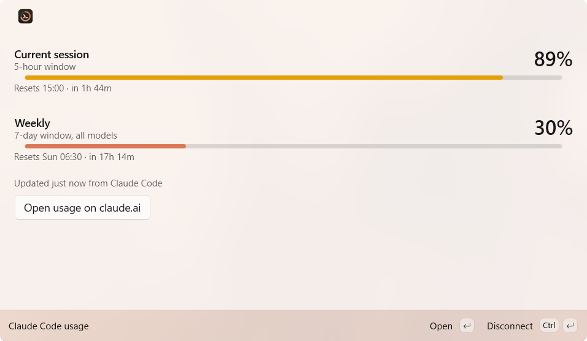

<p align="center">
  
</p>

<h1 align="center">Usage Dock</h1>

<p align="center">
  Your Claude Code 5-hour and weekly usage limits, always visible in the PowerToys Command Palette Dock.
</p>

<p align="center">
  
</p>

## Features

- **Ring gauges** that fill with usage and turn **amber at 80%** and **red at 95%**, so you can read them at a glance.
- **Details on click**: both windows with progress bars, exact reset times and how fresh the data is.
- **Stale data is marked** with `~` (for example `5h ~62%`) when Claude Code hasn't reported in over an hour.
- **Resets are handled for you**: once a window's reset time passes, the Dock shows 0% without waiting for Claude Code.
- **No login, no network**: it never reads your credentials or calls any API.
- **Keeps your status line**: it slots in front of whatever status line you already have.

<p align="center">
  
</p>

## Install

Requires Windows 10/11, [PowerToys](https://github.com/microsoft/PowerToys) with Command Palette and its Dock enabled, and Claude Code on a Claude Pro or Max plan.

**[Get it from the Microsoft Store](https://apps.microsoft.com/detail/9NR3VBPN0XNM)**.

After installing, open Command Palette and run **Connect Usage Dock to Claude Code**. Then right-click the Dock, choose **Edit**, and add the **Usage Dock** band.

<details>
<summary>Install from GitHub instead</summary>

In PowerShell:

```powershell
irm https://raw.githubusercontent.com/Arihant25/usage-dock/main/install.ps1 | iex
```

The script downloads the latest release for your CPU (x64 or ARM64), trusts its signing certificate (a single UAC prompt, because this build is self-signed), installs it, and offers to connect it to Claude Code.

Install one or the other, not both: the Store and GitHub builds are separate apps that both provide `claude-usage-bridge.exe`.

To install by hand:

1. Download `ClaudeUsageDock_<version>_<x64|arm64>.msix` and `UsageDock.cer` from [Releases](https://github.com/Arihant25/usage-dock/releases/latest).
2. In an elevated PowerShell: `Import-Certificate -FilePath UsageDock.cer -CertStoreLocation Cert:\LocalMachine\TrustedPeople`
3. Double-click the `.msix`, or run `Add-AppxPackage <file>.msix`.
4. Open Command Palette and run **Connect Usage Dock to Claude Code**, or run `claude-usage-bridge.exe --connect`.

</details>

## How it works

Claude Code sends a JSON payload to your [status line command](https://code.claude.com/docs/en/statusline) on every update. That payload includes the documented `rate_limits.five_hour` and `rate_limits.seven_day` fields (`used_percentage`, `resets_at`). The extension's executable doubles as a small **bridge**, exposed as the app execution alias `claude-usage-bridge.exe`:

| Status line command | What happens |
|---|---|
| `claude-usage-bridge.exe \| <your command>` | Saves the numbers and passes the JSON through unchanged, so your status line keeps working |
| `claude-usage-bridge.exe --print` | Used if you had no status line. Saves the numbers and prints `5h 76% \| 7d 28%` |

**Connect** makes this edit to `statusLine` in `~/.claude/settings.json` (or `$CLAUDE_CONFIG_DIR/settings.json`) and saves a backup next to it as `settings.json.usage-dock.bak`. Compound commands such as `a && b` are wrapped in parentheses so all of them still receive the JSON. **Disconnect** restores the original command.

The bridge writes `%USERPROFILE%\.claude-usage-dock\usage.json` atomically and the Dock watches that file. When several Claude Code sessions are open, a stale reading from an idle session never overwrites a newer one.

### Good to know

- **Disconnect before uninstalling.** Windows gives MSIX packages no uninstall hook, so the extension can't remove the bridge from your status line command on its own. Run `claude-usage-bridge.exe --disconnect` (or the **Disconnect** command) first.
- Numbers update while Claude Code is getting responses. Usage on claude.ai or the desktop app counts toward the same limits, but it only appears after your next Claude Code response.
- `rate_limits` is only sent for Claude Pro and Max subscribers, starting with the first response in a session.
- If you set `CLAUDE_CONFIG_DIR` only in your shell profile, Command Palette can't see it. Run `claude-usage-bridge.exe --connect` from that shell instead.
- On PowerToys 0.102, clicking a Dock item opens the details in the main Command Palette window. Starting with 0.103 they open in a compact flyout.

## Commands

| Where | Command |
|---|---|
| Command Palette | **Claude Code usage** (details), **Connect Usage Dock to Claude Code**, **Disconnect Usage Dock from Claude Code** |
| Terminal | `claude-usage-bridge.exe --connect`, `claude-usage-bridge.exe --disconnect` |

## Building

All you need is the .NET 10 SDK. `makeappx` and `signtool` come from the `Microsoft.Windows.SDK.BuildTools` NuGet package, so you don't have to install the Windows SDK. Requires PowerShell 7.

```powershell
./pack.ps1 -Register                             # dev: register the unpacked layout (needs Developer Mode)
./pack.ps1 -SelfSign -Install                    # dev: sign with a local cert, trust it (UAC once), install
./pack.ps1 -Version 1.0.0.0 -CertThumbprint ...  # release: sign with a cert from CurrentUser\My
./pack.ps1 -Platform arm64 ...                   # ARM64
```

The output goes to `out/<platform>/`. The certificate subject must match `Publisher` in `ClaudeUsage/Package.appxmanifest`. If you fork the project, change both.

| File | Purpose |
|---|---|
| `Program.cs` | Entry point. Runs as a COM server when Command Palette launches it, and as the bridge or CLI otherwise |
| `StatusLineBridge.cs` | Reads stdin, merges and saves the snapshot, passes the JSON through or prints a summary |
| `ClaudeSettingsConnector.cs` | Connect and disconnect edits to Claude Code's `statusLine` |
| `UsageService.cs` | Watches the snapshot file (debounced) and ticks every 30 s so countdowns stay current |
| `ClaudeUsageCommandsProvider.cs` | Dock band, labels and palette commands |
| `UsageDetailsPage.cs` | Details view (Adaptive Card) |
| `GaugeIcons.cs` | Ring gauge icons for light and dark themes |

## Disclaimer

This is an unofficial community project. It is not affiliated with or endorsed by Anthropic or Microsoft. Claude and Claude Code are trademarks of Anthropic.

## License

[MIT](LICENSE)
